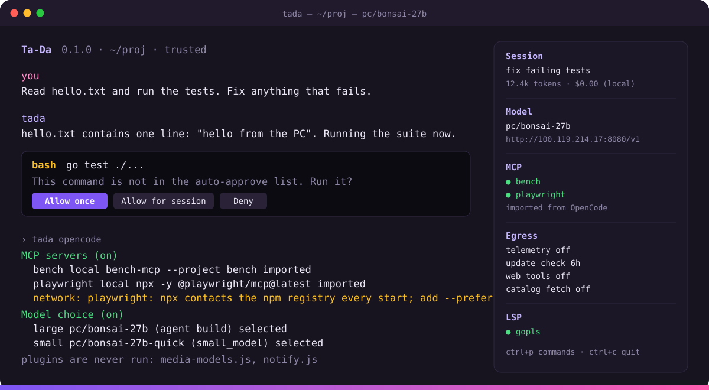

<div align="center">


# Ta-Da

**A terminal coding agent, forked from Charm's Crush and rebuilt to talk to nobody but the model providers and MCP servers you configure. Imports your OpenCode setup. Windows, macOS and Linux.**

[](https://github.com/ItsCetla/tada/releases/latest)
[](https://github.com/ItsCetla/tada/releases)
[](https://github.com/ItsCetla/tada/actions/workflows/build.yml)
[](#download)
[](LICENSE.md)
[](go.mod)

[Download](#download) · [Website](https://tada.cetla.dev/) · [What's different](#whats-different-in-this-fork) · [OpenCode import](#importing-from-opencode) · [Configuration](#configuration) · [Changelog](CHANGELOG.md)



</div>

## What's different in this fork

Ta-Da started as a fork of [Charm's Crush](https://github.com/charmbracelet/crush).
The agent, TUI, LSP and MCP support are upstream's. What changed is who it
talks to and what it does without asking:

- **No phone-home.** Telemetry (PostHog), Charm's update check, the Catwalk and
  Hyper catalog fetches at startup, the Hyper vendor service and the forced
  Termux DNS resolvers are gone. The provider catalog is local; refresh it
  only by running `tada update-providers`.
- **One update check, and you can turn it off.** Ta-Da asks GitHub
  (api.github.com) for its latest release at most every 6 hours and tells you
  once per new version. It never downloads anything on its own. Turn it off
  with `"options": { "update_check": false }`, `option update-check false` in
  `tadarc`, or `TADA_NO_UPDATE_CHECK=1`.
- **Web tools are off.** `fetch`, `agentic_fetch`, `download` and
  `sourcegraph` are hidden from the agent until you turn them on with
  `option web-tools true` (or `options.enable_web_tools`, or
  `TADA_ENABLE_WEB_TOOLS=1`). Even then, every request asks first.
- **Untrusted projects stay inert.** A cloned repo's `tada.json`, `tadarc`,
  `.tada/tada.json` and OpenCode config are ignored until you run
  `tada trust` (see [Project trust](#configuration)). `.env` files are no
  longer auto-loaded.
- **Stricter bash auto-approval.** Only a single, parsed, read-only command
  runs without a prompt; wrappers like `env`/`timeout`, redirections and
  multi-line commands always ask.
- **OpenCode import.** MCP servers, providers, model choices, the cached
  models.dev catalog, rules, skills, custom commands, tool toggles and
  file-edit permissions are picked up from a local OpenCode install, read
  from disk only. OpenCode plugins are never run. See
  [Importing from OpenCode](#importing-from-opencode).
- **Tables, charts and tabs.** Markdown tables in replies are drawn as
  bordered tables, ```` ```chart ```` blocks as bar, line or sparkline charts,
  and open sessions stay as tabs above the chat. Diffs wrap long lines. Set
  `options.tui.rich_blocks` to `false` or `TADA_NO_RICH=1` to show the plain
  markdown instead.

Every fork change is listed in the [changelog](CHANGELOG.md).

## Download

Grab the archive for your machine from the
[latest release](https://github.com/ItsCetla/tada/releases/latest),
unpack it, and put the `tada` binary somewhere on your `PATH`. Each archive
also contains the README, the license, a man page and shell completions.

### Windows

| Build | File | What it does |
| --- | --- | --- |
| x64 installer | `tada_<version>_Windows_x86_64_Setup.exe` | Most PCs. Recommended. |
| ARM64 installer | `tada_<version>_Windows_arm64_Setup.exe` | Snapdragon and other ARM laptops. |
| x64 / ARM64 zip | `tada_<version>_Windows_x86_64.zip`, `..._arm64.zip` | Portable: nothing is installed. Unzip and run `tada.exe`. |

The installer needs no admin rights. It installs to
`%LOCALAPPDATA%\Programs\Ta-Da`, adds that folder to your user `PATH`, adds a
Start menu entry, and shows up in **Settings → Apps** for uninstalling (which
also takes it back off `PATH`). Open a new terminal afterwards:

```powershell
cd C:\path\to\your\project
tada
```

Silent install for scripts: `tada_<version>_Windows_x86_64_Setup.exe /VERYSILENT /SUPPRESSMSGBOXES`.

> [!NOTE]
> The installer and binaries are not code-signed. If SmartScreen appears,
> choose **More info → Run anyway**.

### macOS

| Build | File | What it does |
| --- | --- | --- |
| Apple silicon | `tada_<version>_Darwin_arm64.tar.gz` | M1 and later. |
| Intel | `tada_<version>_Darwin_x86_64.tar.gz` | Intel Macs. |

> [!NOTE]
> The binaries are not notarized. If macOS refuses to run a binary you
> downloaded with a browser, remove the quarantine flag:
> `xattr -d com.apple.quarantine ./tada`.

```bash
tar -xzf tada_<version>_Darwin_arm64.tar.gz
sudo install tada_<version>_Darwin_arm64/tada /usr/local/bin/tada
tada --version
```

### Linux

| Build | File | What it does |
| --- | --- | --- |
| x64 | `tada_<version>_Linux_x86_64.tar.gz` | Any glibc or musl distro; the binary is static. |
| ARM64 | `tada_<version>_Linux_arm64.tar.gz` | Raspberry Pi 4/5, Graviton, Ampere. |

```bash
tar -xzf tada_<version>_Linux_x86_64.tar.gz
sudo install tada_<version>_Linux_x86_64/tada /usr/local/bin/tada
tada --version
```

### Checking a download

Every release ships a `SHA256SUMS.txt`. Put it next to the archive and run:

```bash
# macOS / Linux
shasum -a 256 -c SHA256SUMS.txt --ignore-missing
```

```powershell
# Windows
Get-FileHash tada_<version>_Windows_x86_64_Setup.exe
Select-String Windows_x86_64_Setup SHA256SUMS.txt
```

The two hashes must match.

### Build from source

Package managers (Homebrew, npm, AUR, Nix, …) install upstream Crush, not
this fork. Building needs Go 1.27+ and no other dependencies on any platform.

| Command | What it does |
| --- | --- |
| `go build -o tada .` | Build for the current machine into `./tada`. |
| `go install .` | Build into `$(go env GOPATH)/bin`. |
| `GOOS=windows GOARCH=amd64 CGO_ENABLED=0 go build -o tada.exe .` | Cross-compile a Windows binary from macOS or Linux. |
| `goreleaser release --snapshot --clean` | Every release archive into `dist/` (needs [goreleaser](https://goreleaser.com)). |
| `go test ./...` | Run the test suite. |

```bash
git clone https://github.com/ItsCetla/tada.git
cd tada
go build -o tada .
./tada --version
```

Tagging `vX.Y.Z` runs the `release` workflow, which builds all six archives
and opens a **draft** release with the matching `CHANGELOG.md` section as
its notes. Nothing is published until the draft is reviewed.

## Features

- **Multi-Model:** choose from a wide range of LLMs or add your own via OpenAI- or Anthropic-compatible APIs
- **Flexible:** switch LLMs mid-session while preserving context
- **Session-Based:** maintain multiple work sessions and contexts per project
- **LSP-Enhanced:** Ta-Da uses LSPs for additional context, just like you do
- **Extensible:** add capabilities via MCPs (`http`, `stdio`, and `sse`)
- **Works Everywhere:** first-class support in every terminal on macOS, Linux, Windows (PowerShell and WSL), Android, FreeBSD, OpenBSD, and NetBSD
- **Industrial Grade:** built on the Charm ecosystem, powering 25k+ applications, from leading open source projects to business-critical infrastructure

## Getting Started

Press <kbd>ctrl+l</kbd> to open the model picker, choose a provider and paste
its API key, or set one of the environment variables below. GitHub Copilot,
ChatGPT and Grok accounts can also sign in with `tada login`.

## API Keys

You can use Ta-Da with many providers such as Anthropic, OpenAI, Gemini,
OpenRouter and so on. Press <kbd>ctrl+l</kbd> to open the model picker,
choose the provider of your choice, and paste your API key.

That said, you can also set environment variables for preferred providers:

| Environment Variable        | Provider                                           |
| --------------------------- | -------------------------------------------------- |
| `ANTHROPIC_API_KEY`         | Anthropic                                          |
| `OPENAI_API_KEY`            | OpenAI                                             |
| `VERCEL_API_KEY`            | Vercel AI Gateway                                  |
| `GEMINI_API_KEY`            | Google Gemini                                      |
| `ZAI_API_KEY`               | Z.ai                                               |
| `MINIMAX_API_KEY`           | MiniMax                                            |
| `SYNTHETIC_API_KEY`         | Synthetic                                          |
| `HF_TOKEN`                  | Hugging Face Inference                             |
| `CEREBRAS_API_KEY`          | Cerebras                                           |
| `OPENROUTER_API_KEY`        | OpenRouter                                         |
| `IONET_API_KEY`             | io.net                                             |
| `ALIBABA_SINGAPORE_API_KEY` | Alibaba (Singapore)                                |
| `ALIBABA_US_API_KEY`        | Alibaba (United States)                            |
| `GROQ_API_KEY`              | Groq                                               |
| `AVIAN_API_KEY`             | Avian                                              |
| `OPENCODE_API_KEY`          | OpenCode Zen & Go                                  |
| `VERTEXAI_PROJECT`          | Google Cloud VertexAI (Gemini)                     |
| `VERTEXAI_LOCATION`         | Google Cloud VertexAI (Gemini)                     |
| `AWS_ACCESS_KEY_ID`         | Amazon Bedrock (Claude)                            |
| `AWS_SECRET_ACCESS_KEY`     | Amazon Bedrock (Claude)                            |
| `AWS_REGION`                | Amazon Bedrock (Claude)                            |
| `AWS_PROFILE`               | Amazon Bedrock (Custom Profile)                    |
| `AWS_BEARER_TOKEN_BEDROCK`  | Amazon Bedrock                                     |
| `AZURE_OPENAI_API_ENDPOINT` | Azure OpenAI models                                |
| `AZURE_OPENAI_API_KEY`      | Azure OpenAI models (optional when using Entra ID) |
| `AZURE_OPENAI_API_VERSION`  | Azure OpenAI models                                |
| `MOONSHOT_API_KEY`          | Moonshot                                           |

Also note that Ta-Da can support nearly any provider, including
[Local Models](#local-models). For more info see
[Custom Providers](#custom-providers) below.

### By the Way

Is there a provider you’d like to see in Ta-Da? Is there an existing model that needs an update?

Ta-Da’s default model listing is managed in [Catwalk](https://github.com/charmbracelet/catwalk), a community-supported, open source repository of Crush-compatible models (Ta-Da reads it too), and you’re welcome to contribute.

<a href="https://github.com/charmbracelet/catwalk"></a>

## Configuration

> [!TIP]
> Ta-Da ships with a builtin skill for configuring itself. Most of the time
> you can just tell what you want it to configure and it will get the job done.

Ta-Da runs great with no configuration. That said, if you do need or want to
customize Ta-Da, you can, with a `tadarc`.

A `tadarc` is just Bash with some Ta-Da-specific builtins. It’s a lot like
a `.bashrc`, just for your Ta-Da. Because Ta-Da has a native, built-in Bash
interpreter, Bash-based config works identically across all platforms, including
Windows.

For example:

```bash
# Add Ollama.
provider add ollama --type ollama --base-url "http://localhost:11434/v1"

# Register a model on Ollama.
model add ollama/llama3.3 --name "Llama 3.3" --context-window 128000

# Auto-approve some tools.
permissions allow view edit

# Include some other file on a specific machine.
if [[ $HOSTNAME == "babysquid" ]]; then
    source ~/my-stuff/babysquid.sh
fi

# Add an MCP server, with a GitHub API token stored in 1Password.
mcp add github \
  --type http \
  --url "https://api.github.com/mcp/" \
  --header Authorization "Bearer $(op read 'op://my-secret-key')"
```

Configuration can be added either local to the project itself, or globally,
with the following priority:

| Priority | Unix-like                 | Windows                               |
| -------- | ------------------------- | ------------------------------------- |
| 1        | `./.tadarc`              | `.\.tadarc`                          |
| 2        | `./tadarc`               | `.\tadarc`                           |
| 3        | `~/.config/tada/tadarc` | `%USERPROFILE%\.config\tada\tadarc` |

(Ta-Da respects the [XDG Base Directory Specification][xdg], so your paths
may differ depending on your `XDG_CONFIG_HOME` value. Data directories such as
`~/.local/share/tada` and `%LOCALAPPDATA%\tada` contain JSON state only; Ta-Da
does not execute a `tadarc` from them.)

[xdg]: https://specifications.freedesktop.org/basedir-spec/basedir-spec-latest.html

What about the old JSON format? It’s still supported, but it should be
considered deprecated. See: [the config docs](./docs/config/) for details.

> [!TIP]
> You can override the user and data config locations by setting:
>
> - `TADA_GLOBAL_CONFIG`
> - `TADA_GLOBAL_DATA`

As an additional note, Ta-Da also stores ephemeral data, such as application
state, in one additional location. This is state and should not be edited by
hand, nor should it be considered configuration.

```bash
# Unix
$HOME/.local/share/tada/tada.json

# Windows
%LOCALAPPDATA%\tada\tada.json
```

#### A note on security

Both `tadarc` and `tada.json` are trusted code; `tadarc` runs in a full
shell, and any `$(...)` in `tada.json` runs at load time. Don't randomly
`source` files from the internet into your config.

That's why Ta-Da ignores a project's own config (any `tadarc`, `.tadarc`,
`tada.json` or `.tada.json` in the project, plus the workspace config
`.tada/tada.json`) until you trust the project. Review those files, then
run:

```bash
tada trust            # trust the project in the current directory
tada trust --list     # list trusted projects
tada trust --revoke   # stop trusting it
```

Ta-Da remembers a fingerprint of the files: if any of them changes, appears
or disappears, it ignores them again until you run `tada trust` once more.
Changes Ta-Da makes to `.tada/tada.json` itself don't count. To trust every
project under a directory you control, add it to `options.trusted_paths` in
your global config (it's ignored in project config); for a single run, set
`TADA_TRUST_PROJECT=1`.

### Environment Variables

The top-level `env` field sets environment variables at startup, before
providers are configured. This is useful for variables that affect provider
authentication (e.g. the AWS SDK credential chain) without wrapping the
`tada` command in a shell script or exporting them in your shell profile:

```json
{
  "$schema": "https://tada.cetla.dev.json",
  "env": {
    "AWS_PROFILE": "my-sso-profile"
  }
}
```

Values support the same `$VAR` and `$(command)` expansion as other config
fields, so you can reference existing environment variables or shell out for
a value.

### Themes

Ta-Da ships with built-in color themes.

#### Switching Themes

Open the command palette with `ctrl+p`, select **Themes**, and browse the
list. The UI previews each theme as you navigate, and pressing `enter`
confirms the selection. Press `esc` to cancel and revert.

#### Editing Themes

Open **Themes**, highlight the theme to customize, and press `ctrl+e`.
Changes preview live as you type. Press `enter` or `ctrl+s` to save, or `esc`
to cancel and revert. User themes are stored globally in the Ta-Da config
directory under `themes/`.

You can also select a theme directly in your config with `active_theme`:

```json
{
  "$schema": "https://tada.cetla.dev.json",
  "options": {
    "tui": {
      "active_theme": "gruvbox-dark"
    }
  }
}
```

Custom theme palettes are stored as JSON files in the global theme directory.
For example, `~/.config/tada/themes/my-theme.json`:

```json
{
  "base": "gruvbox-dark",
  "primary": "#ff6b6b",
  "bg_base": "#1a1a2e"
}
```

Select it by setting `active_theme` to `my-theme` or from the **Themes**
dialog.

#### Built-In Themes

| Theme | Name |
| --- | --- |
| Charmtone Pantera | `charmtone-panther` (default) |
| Gruvbox Dark | `gruvbox-dark` |

### LSPs

Ta-Da can use LSPs for additional context to help inform its decisions, just
like you would. LSPs can be added manually like so:

```bash
# tadarc

lsp add go --command "gopls" --env "GOTOOLCHAIN go1.24.5"
lsp add typescript --command "typescript-language-server" --args --stdio
lsp add nix --command "nil"
```

### MCPs

Ta-Da also supports Model Context Protocol (MCP) servers through three transport
types: `stdio` for command-line servers, `http` for HTTP endpoints, and `sse`
for Server-Sent Events.

```bash
# tadarc

# Add a local MCP server that runs a Node.js script.
mcp add filesystem --command node --args /path/to/mcp-server.js \
  --timeout 10 --disabled-tools some-tool-name --env NODE_ENV production

# Add a GitHub MCP server that uses an API token.
mcp add github --type http --url https://api.github.com/mcp/ \
  --timeout 10 --header Authorization "Bearer $GH_PAT" \
  --disabled-tools create_issue --disabled-tools create_pull_request

# Add a streaming MCP server that uses SSE.
mcp add streaming-service --type sse --url "https://example.com/mcp/sse" \
  --timeout 10 --header API-Key "$API_KEY"
```

#### MCP OAuth

HTTP and SSE MCP servers that require OAuth can use Ta-Da's built-in
authorization-code flow instead of a static `Authorization` header. Set
`"oauth": true` to enable it:

```json
{
  "mcp": {
    "linear": {
      "type": "http",
      "url": "https://mcp.linear.app/mcp",
      "oauth": true
    }
  }
}
```

##### Pre-registered clients

Some servers (GitHub, Slack) don't support dynamic client registration.
For those, register an OAuth app with the provider and supply the
credentials directly. All values support shell expansion:

```json
{
  "mcp": {
    "github": {
      "type": "http",
      "url": "https://api.github.com/mcp/",
      "oauth": true,
      "oauth_client_id": "Iv1.abc123def456",
      "oauth_client_secret": "$GITHUB_MCP_SECRET",
      "oauth_callback_port": 40704
    }
  }
}
```

When `oauth_client_id` is set, Ta-Da skips dynamic client registration
and authenticates as the specified client. When omitted, Ta-Da attempts
dynamic registration automatically (works with Linear, Notion, and other
servers that support RFC 7591).

#### Sessionless servers

Some HTTP MCP servers are sessionless — they never issue a
`Mcp-Session-Id` and reject the `subscriptions/listen` stream Ta-Da opens
for list-changed notifications, which would otherwise break the
connection. Ta-Da auto-detects known sessionless servers (GitHub MCP,
`api.githubcopilot.com/mcp`), so those need no extra configuration.

For other sessionless servers, mark them explicitly with
`"sessionless": true` (or `--sessionless true` in `tadarc`); set it to
`false` to force the default behavior for an auto-detected URL. The
tradeoff is that a sessionless server won't push live
tool/prompt/resource list-changed notifications.

### Hooks

Ta-Da has preliminary support for hooks. For details, see
[the hook guide](./docs/hooks/).

### Sharing a workspace across clients

When Ta-Da is run against a shared backend (for example two TUIs talking to
the same `tada serve`), clients are grouped into **workspaces** keyed by
their resolved `--cwd`. Two clients with the same `--cwd` join the same
underlying workspace, so they share the session list, message history,
permission queue, LSP, and MCP state.

Joining is implicit: pointing a second client at the same working directory
attaches it to the existing workspace. Each new invocation, however, starts
in its own fresh session by default. To pick up the conversation another
client already has open, use the session manager (the session picker) and
select it. Sessions surface two signals there:

- `IsBusy` is set while an agent turn is in flight for that session.
- `AttachedClients` reports how many clients are currently viewing it.

A non-zero `AttachedClients` (often combined with `IsBusy`) is the cue that a
session is "in progress" on another client and joining it will mirror that
view live.

The first client to create a workspace fixes its process-wide flags. In
particular, `--auto` (or `--yolo`) and `--debug` follow a **first-wins** rule: later
clients that arrive at the same `--cwd` with different values for those
flags do not change the running workspace. A debug log line is emitted
recording the mismatch, and the workspace keeps the flags it was created
with.

A workspace lives as long as at least one client has an SSE event stream
open against it. When the last stream disconnects, the workspace is torn
down. There is a short grace window right after `POST /v1/workspaces` so a
client that has created the workspace but not yet opened its event stream
does not get reaped before it can attach.

### Global context files

Ta-Da automatically includes two files for cross-project instructions. Think of
these are personal additions to the system prompt.

- `~/.config/tada/TADA.md`: Ta-Da-specific rules that would confuse other
  agentic coding tools. If you only use Ta-Da, this is the only one you need to
  edit.
- `~/.config/AGENTS.md`: generic instructions that other coding tools might
  read. Avoid referring to Ta-Da-specific features or workflows here. You
  probably only care about this if you use multiple agentic coding tools and
  want to share instructions between them.

You can customize these paths with `option global-context-path`. Repeat the
command to add multiple paths:

```bash
# Load a single markdown file.
option global-context-path "~/path/to/custom/context/file.md"

# Recursively load all Markdown files in the folder.
option global-context-path "/full/path/to/folder/of/files/"
```

### Ignoring Files

Ta-Da respects `.gitignore` files by default, but you can also create a
`.tadaignore` file to specify additional files and directories that Ta-Da
should ignore. This is useful for excluding files that you want in version
control but don't want Ta-Da to consider when providing context.

The `.tadaignore` file uses the same syntax as `.gitignore` and can be placed
in the root of your project or in subdirectories.

### Allowing Tools

By default, Ta-Da will ask you for permission before running tool calls. If
you'd like, you can allow tools to be executed without prompting you for
permissions. Use this with care.

The tools that reach the network (`fetch`, `download`, `agentic_fetch`, and
`sourcegraph`, which sends its search query to sourcegraph.com) are off until
you enable them with `option web-tools true`. Once enabled, they ask before
every call unless allowed here.

```bash
permissions allow view ls grep edit mcp_context7_get-library-doc
```

To skip the prompt for file edits only when the file is inside the project,
use `allow-in-project` instead (`permissions.project_allowed_tools` in
`tada.json`). Edits outside the project, including through symlinks, still
ask:

```bash
permissions allow-in-project edit multiedit write
```

### Disabling Built-In Tools

You can also deny tools, hiding then from the agent entirely:

```bash
permissions deny bash sourcegraph
```

To disable tools from MCP servers, see the [MCP config section](#mcps).

### Permission modes

Ta-Da has three modes. Press **Shift+Tab** to cycle through them; the current
one is always shown at the left of the status bar.

| Mode   | What it does                                                                 |
| ------ | ---------------------------------------------------------------------------- |
| Manual | The default. Ta-Da asks before editing files or running commands.           |
| Plan   | A read-only planner. It can look around but not change anything, and hands you a plan to start coding from. |
| Auto   | Skips permission prompts. System level commands are still blocked.          |

**Ctrl+Y** turns Auto on or off from any mode, and `tada --auto` starts in it
(`--yolo` still works too). Be very, very careful with Auto.

### Disabling Skills

You can prevent Ta-Da from using certain skills entirely. Disabled skills are
hidden from the agent, including builtin skills and skills discovered from
disk.

```bash
option disable-skill tada-config
```

### Agent Skills

Ta-Da supports the [Agent Skills](https://agentskills.io) open standard for
extending agent capabilities with reusable skill packages. Skills are folders
containing a `SKILL.md` file with instructions that Ta-Da can discover and
activate on demand.

The global paths we looks for skills are:

- `$TADA_SKILLS_DIR`
- `$XDG_CONFIG_HOME/agents/skills` or `~/.config/agents/skills/`
- `$XDG_CONFIG_HOME/tada/skills` or `~/.config/tada/skills/`
- `~/.agents/skills/`
- `~/.claude/skills/`
- On Windows, we _also_ look at
  - `%LOCALAPPDATA%\agents\skills\` or `%USERPROFILE%\AppData\Local\agents\skills\`
  - `%LOCALAPPDATA%\tada\skills\` or `%USERPROFILE%\AppData\Local\tada\skills\`
- Additional paths configured via `options.skills_paths`

On top of that, we _also_ load skills in your project from the following
relative paths:

- `.agents/skills`
- `.tada/skills`
- `.claude/skills`
- `.cursor/skills`

Or load directories of skills specifically in your config:

```bash
option skill-path "$HOME/squid-skills" "./other-skills"
```

You can get started with example skills from [anthropics/skills](https://github.com/anthropics/skills):

```bash
# Unix
mkdir -p ~/.config/tada/skills
cd ~/.config/tada/skills
git clone https://github.com/anthropics/skills.git _temp
mv _temp/skills/* . && rm -rf _temp
```

```powershell
# Windows (PowerShell)
mkdir -Force "$env:LOCALAPPDATA\tada\skills"
cd "$env:LOCALAPPDATA\tada\skills"
git clone https://github.com/anthropics/skills.git _temp
mv _temp/skills/* . ; rm -r -force _temp
```

#### User-Invocable Skills

Skills can be made invocable as commands from the commands palette
(<kbd>ctrl+p</kbd>). Add `user-invocable: true` to the skill's YAML
frontmatter:

```yaml
---
name: my-hot-skill
description: A skill that can be invoked as a command.
user-invocable: true
---
```

User-invocable skills appear in the commands palette with a `user:` or `project:` prefix:

- Skills from global directories show as `user:skill-name`
- Skills from project directories show as `project:skill-name`

When invoked, the skill's instructions are loaded into the conversation context.

To prevent the model from auto-triggering a skill (while still allowing user invocation), add `disable-model-invocation: true`:

```yaml
---
name: my-skill
description: Only invocable by users, not the model.
user-invocable: true
disable-model-invocation: true
---
```

Skills with `disable-model-invocation` won't appear in the model's available skills list but can still be invoked manually by users.

### Desktop notifications

Ta-Da sends desktop notifications when a tool call requires permission and when
the agent finishes its turn. They're only sent when the terminal window isn't
focused _and_ your terminal supports reporting the focus state.

```bash
# Choose auto, native, osc, bell, or disabled.
option notifications disabled
```

`auto` uses native notifications locally and OSC notifications over SSH when
supported.

### Initialization

When you initialize a project, Ta-Da analyzes your codebase and creates
a context file that helps it work more effectively in future sessions. By
default, this file is named `AGENTS.md`, but you can customize the name and
location with the `initialize-as` option:

```bash
# tadarc
option initialize-as AGENTS.md
```

This is useful if you prefer a different naming convention or want to place the
file in a specific directory (e.g., `TADA.md` or `docs/LLMs.md`). Ta-Da will
fill the file with project-specific context like build commands, code patterns,
and conventions it discovered during initialization.

### Attribution Settings

By default, Ta-Da adds attribution information to Git commits and pull requests
it creates. You can customize this behavior with `option` commands:

```bash
option attribution-trailer-style co-authored-by
option attribution-generated-with true
```

- `trailer_style`: Controls the attribution trailer added to commit messages
  (default: `assisted-by`)
  - `assisted-by`: Adds `Assisted-by: Ta-Da:[ModelID]` as specified in [the convention](https://docs.kernel.org/process/coding-assistants.html#attribution)
  - `co-authored-by`: Adds `Co-Authored-By: Ta-Da <tada@cetla.dev>`
  - `none`: No attribution trailer
- `generated_with`: When true (default), adds `💘 Generated with Ta-Da` line to
  commit messages and PR descriptions

### Custom Providers

Ta-Da supports custom provider configurations for both OpenAI-compatible and
Anthropic-compatible APIs.

> [!NOTE]
> Note that we support two "types" for OpenAI. Make sure to choose the right one
> to ensure the best experience!
>
> - `openai` should be used when proxying or routing requests through OpenAI.
> - `openai-compat` should be used when using non-OpenAI providers that have OpenAI-compatible APIs.

#### OpenAI-Compatible APIs

Here’s an example configuration for Deepseek, which uses an OpenAI-compatible
API. Don't forget to set `DEEPSEEK_API_KEY` in your environment.

```bash
provider add deepseek --type openai-compat \
  --base-url "https://api.deepseek.com/v1" \
  --api-key "$DEEPSEEK_API_KEY"

model add deepseek/deepseek-chat \
  --name "Deepseek V3" \
  --context-window 64000 \
  --default-max-tokens 5000 \
  --price-input 0.27 \
  --price-output 1.1 \
  --price-cache-create 1.1 \
  --price-cache-hit 0.07
```

#### Anthropic-Compatible APIs

Custom Anthropic-compatible providers follow this format:

```bash
provider add custom-anthropic \
  --type anthropic \
  --base-url "https://api.anthropic.com/v1" \
  --api-key "$ANTHROPIC_API_KEY" \
  --extra-header anthropic-version 2023-06-01

model add custom-anthropic/claude-sonnet-4-20250514 \
  --name "Claude Sonnet 4" \
  --context-window 200000 \
  --default-max-tokens 50000 \
  --can-reason true \
  --supports-images true \
  --price-input 3 \
  --price-output 15 \
  --price-cache-create 3.75 \
  --price-cache-hit 0.3
```

### Amazon Bedrock

Ta-Da currently supports running Anthropic models through Bedrock, with caching disabled.

A Bedrock provider appears once Ta-Da can find AWS credentials. You can
authenticate in one of two ways:

**API key.** Set `AWS_BEARER_TOKEN_BEDROCK` to a Bedrock API key. This is the
simplest option and never expires mid-session.

**AWS credential chain (SSO, profiles, access keys).** Configure AWS the usual
way with `aws configure` or `aws configure sso`. Ta-Da picks up whatever the
AWS SDK credential chain resolves, including `AWS_PROFILE`, `AWS_ACCESS_KEY_ID`
/ `AWS_SECRET_ACCESS_KEY`, or an SSO session. To select a specific profile,
set `AWS_PROFILE` in your shell (`AWS_PROFILE=myprofile tada`) or in the
top-level [`env`](#environment-variables) config.

If you authenticate via AWS SSO, your session expires periodically. Set
`aws_auth_refresh` to a command that refreshes it. When Bedrock returns a
credential error, Ta-Da runs the command, then retries the request in place
(no duplicate messages, no manual restart):

```json
{
  "$schema": "https://tada.cetla.dev.json",
  "env": {
    "AWS_PROFILE": "my-sso-profile"
  },
  "providers": {
    "bedrock": {
      "aws_auth_refresh": "aws sso login --profile my-sso-profile"
    },
    "bedrock-europe": {
      "aws_auth_refresh": "aws sso login --profile my-eu-sso-profile"
    }
  }
}
```

- `aws_auth_refresh` — shell command run when AWS credentials expire (e.g. `aws sso login`)

### Vertex AI Platform

Vertex AI will appear in the list of available providers when `VERTEXAI_PROJECT` and `VERTEXAI_LOCATION` are set. You will also need to be authenticated:

```bash
$ gcloud auth application-default login
```

To add specific models to the configuration, configure as such:

```bash
# tadarc — authentication still comes from gcloud and the VERTEXAI_* env vars.
provider add vertexai --type google-vertex

model add vertexai/claude-sonnet-4@20250514 \
  --name "VertexAI Sonnet 4" \
  --context-window 200000 \
  --default-max-tokens 50000 \
  --can-reason true \
  --supports-images true \
  --price-input 3 \
  --price-output 15 \
  --price-cache-create 3.75 \
  --price-cache-hit 0.3
```

### Local Models

Ta-Da can auto-discovers models from local providers. Add a custom provider
with `type` set to `llamacpp`, `omlx`, `lmstudio`, `litellm`, or `ollama`
and leave out the models list. Ta-Da will populate the model list
automatically.

```bash
# Piece of cake.
provider add ollama \
  --name Ollama \
  --type ollama \
  --base-url "http://localhost:11434/v1/"
```

For llama.cpp (`llama-server`), point at the server's base URL:

```bash
provider add llamacpp \
  --name "llama.cpp" \
  --type llamacpp \
  --base-url "http://localhost:2222"
```

#### Manual Model Configuration

You can still list models explicitly. User-defined models always take
precedence over discovered ones, and any fields you set won't be overwritten
by auto-discovery. Auto discovery will run if the model list is empty for any
`openai-compat` provider or if you pass `"discover_models": true` it will merge
the found models with your hand configured ones.

```bash
# tadarc
provider add ollama \
  --name Ollama \
  --type ollama \
  --base-url "http://localhost:11434/v1/" \
  --discover-models true

model add ollama/qwen3:30b \
  --name "Qwen 3 30B" \
  --context-window 256000 \
  --default-max-tokens 20000
```

The `--discover-models true` flag merges discovered models with the one above;
your explicit model fields win on conflicts.

## Logging

Sometimes you need to look at logs. Luckily, Ta-Da logs all sorts of
stuff. Logs are stored in `./.tada/logs/tada.log` relative to the project.

The CLI also contains some helper commands to make perusing recent logs easier:

```bash
# Print the last 1000 lines
tada logs

# Print the last 500 lines
tada logs --tail 500

# Follow logs in real time
tada logs --follow
```

Want more logging? Run `tada` with the `--debug` flag, or enable it in your
`tadarc`:

```bash
# tadarc
option debug true
option debug-lsp true
```

## Provider Catalog

Ta-Da’s list of providers and models comes from
[Catwalk](https://github.com/charmbracelet/catwalk), the open source Ta-Da
provider database. Ta-Da never updates it on its own and makes no network
request to load it: it uses the catalog saved by `tada update-providers` or,
if none has been saved, the catalog embedded in the release.

The `provider-auto-update` option and the `TADA_DISABLE_PROVIDER_AUTO_UPDATE`
environment variable are deprecated and have no effect.

### Updating providers

`tada update-providers` is the only way to refresh the catalog. Without an
argument it downloads the catalog from `https://catwalk.charm.land`, or from
`CATWALK_URL` when set (e.g. `export CATWALK_URL=http://localhost:8000` for a
fork):

```bash
# Update providers remotely from Catwalk.
tada update-providers

# Update providers from a custom Catwalk base URL.
tada update-providers https://example.com/

# Update providers from a local file.
tada update-providers /path/to/local-providers.json

# Reset providers to the embedded version, embedded at tada at build time.
tada update-providers embedded

# For more info:
tada update-providers --help
```

## Importing from OpenCode

If you use [OpenCode](https://opencode.ai), Ta-Da picks up its setup
automatically, reading only OpenCode's files on disk. Nothing is fetched,
and OpenCode plugins are never run.

| What | Where it comes from | Default |
| --- | --- | --- |
| MCP servers | `mcp` in OpenCode config (V1 and V2 shapes) | on |
| Provider settings | `provider` / `providers`: base URLs, API keys, headers, custom models; `enabled_providers` / `disabled_providers` | on |
| Model choice | The default agent's `model`, else `model`, and `small_model`; used only when Ta-Da has no selection | on |
| Models catalog | OpenCode's cached models.dev catalog (`opencode.db`, `~/.cache/opencode/models.json` or `$OPENCODE_MODELS_PATH`) | on |
| Instructions | `instructions` files, plus the global `AGENTS.md` (or `~/.claude/CLAUDE.md`) | on |
| Skills | `skill(s)/` in OpenCode config directories and `skills.paths` | on |
| Commands | `command` entries and `command(s)/*.md`, as `opencode:<name>` commands | on |
| Tool toggles | `tools` toggles for built-in tools and MCP servers | on |
| Permissions | `"edit": "allow"` and whole-tool `"deny"` rules | on |
| Compaction | `compaction.auto: false` turns off auto-summarize | on |
| API keys | `opencode auth login` keys (OAuth logins are never imported) | **off** |

OpenCode config is read from `~/.config/opencode/` (or `$XDG_CONFIG_HOME`,
`$OPENCODE_CONFIG_DIR`), `$OPENCODE_CONFIG` and `$OPENCODE_CONFIG_CONTENT`,
with `{env:VAR}` and `{file:path}` substituted the way OpenCode does.
Project-level `opencode.json(c)` and `.opencode/` files are only read in
projects you have trusted with `tada trust`, and editing them requires
trusting the project again. Imported settings live in memory only; Ta-Da
never writes them to its own config.

Ta-Da's own config always wins: an MCP server, provider field or model
selection set in Ta-Da overrides the imported one. The models catalog adds
the models Catwalk lacks to the providers Ta-Da already knows, and lists
OpenCode-only providers once their API key variable is set or they are
configured. Only chat models that can call tools, from providers Ta-Da can
talk to, are added.

Some settings can't be carried over exactly, and the import never loosens
anything else:

- `"edit": "allow"` lets `edit`, `multiedit`, `write` and
  `lsp_replace_symbol` run without a prompt, but only for files inside the
  project (see `project_allowed_tools` under [Allowing Tools](#allowing-tools)).
  Other `allow` rules are not imported, so Ta-Da keeps prompting for
  commands, web access and MCP tools.
- A whole-tool `"deny"` rule or a `false` tools toggle hides the matching
  tools. A toggle that an OpenCode agent turns back on is skipped.
- Commands run in the current session; their `agent`, `model` and `subtask`
  settings are ignored. `$1`, `$2`, … and `$ARGUMENTS` become Ta-Da command
  arguments.
- Remote instructions (URLs) are never fetched.

See what was imported, and what was skipped and why, with:

```bash
tada opencode
```

Tune or turn it off in `tada.json`:

```json
{
  "options": {
    "opencode": {
      "mcp": true,
      "providers": true,
      "models": true,
      "credentials": false,
      "instructions": true,
      "skills": true,
      "commands": true,
      "tools": true,
      "permissions": true,
      "compaction": true
    }
  }
}
```

Set `"disabled": true` there, or `TADA_DISABLE_OPENCODE=1`, to turn the import
off entirely. `"providers": false` also turns off the model choice and
OpenCode's `enabled_providers` / `disabled_providers` filter. Imported remote
MCP servers connect to their URLs like any other configured server; an
OpenCode remote server only uses OAuth in Ta-Da when its config has an
explicit `oauth` block (add `"oauth": true` for it in `tada.json`
otherwise).

## Updating

```bash
tada update          # check GitHub, show what's new, ask, then install
tada update --check  # only check
tada update -y       # install without asking
```

The download is checked against the release's `SHA256SUMS.txt` before the
binary is replaced. If you installed with the Windows installer, quit Ta-Da
and run `tada update` from a new terminal (Windows can't replace a running
`.exe`). `tada update` works even when the background check is off.

## Privacy

This fork collects no telemetry. Apart from the release check described
below, the only network connections it makes are to the model providers and MCP servers you
configure (plus model discovery against those providers' `/models`
endpoints and OAuth refreshes for accounts you signed in with `tada login`).

## Q&A

### Why is clipboard copy and paste not working?

Installing an extra tool might be needed on Unix-like environments.

| Environment         | Tool                     |
| ------------------- | ------------------------ |
| Windows             | Native support           |
| macOS               | Native support           |
| Linux/BSD + Wayland | `wl-copy` and `wl-paste` |
| Linux/BSD + X11     | `xclip` or `xsel`        |

## Contributing

Issues and pull requests for fork-specific behaviour (trust gate, egress,
OpenCode import, releases) are welcome at
[ItsCetla/tada](https://github.com/ItsCetla/tada/issues).
Keep new network egress opt-in and ask-before-use, and add a line to
`CHANGELOG.md` under *Unreleased*.

```bash
go build ./... && go vet ./internal/opencode/... ./internal/config/... && go test ./...
```

## Security

Found something that lets Ta-Da read, send or run what it shouldn't? Please
open a [private security advisory](https://github.com/ItsCetla/tada/security/advisories/new)
rather than a public issue. `govulncheck` runs weekly in CI.

## Upstream

Ta-Da is made by [Charm](https://charm.land). Bug reports for code that isn't
specific to this fork belong [upstream](https://github.com/ItsCetla/tada).

## License

[FSL-1.1-MIT](LICENSE.md), the same license as upstream Ta-Da.

---

Part of [Charm](https://charm.land).

<a href="https://charm.land/"></a>

<!--prettier-ignore-->
Charm热爱开源 • Charm loves open source
